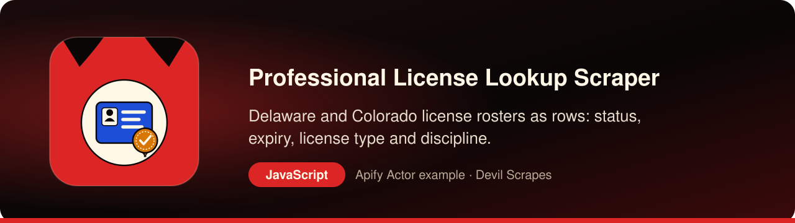

<p align="center"><a href="https://apify.com/DevilScrapes/professional-license-lookup-scraper"></a></p>

# Professional License Lookup for Node.js: verify Delaware and Colorado licenses from your backend

<p align="center">
<a href="https://apify.com/DevilScrapes/professional-license-lookup-scraper"></a>

<a href="LICENSE"></a>
<a href="https://github.com/devilscrapes/professional-license-lookup-scraper-javascript/actions/workflows/ci.yml"></a>
</p>

Use this repository to call the **[Professional License Lookup Scraper](https://apify.com/DevilScrapes/professional-license-lookup-scraper)** from a Node.js service. The whole client is a single ES module that wraps Apify's `apify-client` library. You send a license number, a profession or the name of a firm, and receives plain objects describing matching licenses from the Delaware and Colorado licensing rosters: holder, profession, license type, current status, issue and expiry dates, a discipline flag and a link back to the state record. Apify runs the collection in the cloud, so an onboarding API, a scheduled worker or a serverless function never has to learn two state data portals and their quirks. Run `node index.js` for files on disk, or copy the core call into your own handler.

> **Actor:** [Professional License Lookup Scraper — DE + CO Roster Export](https://apify.com/DevilScrapes/professional-license-lookup-scraper) · **Publisher:** [Devil Scrapes](https://apify.com/DevilScrapes) · **Also in Python:** [professional-license-lookup-scraper-python](https://github.com/devilscrapes/professional-license-lookup-scraper-python)

## 🔥 What you get

- **Two state rosters behind one schema**: Delaware and Colorado name their columns differently and code their statuses differently; every row comes back with the same sixteen keys regardless of which state answered.
- **A status you can filter on**: the state's own wording stays in `status`, and `status_normalized` sorts it into `active`, `inactive` or `unknown`. Delaware's probation and Colorado's conditional or provisional licenses count as active.
- **Discipline taken from where each state actually records it**: Colorado marks it on the license record itself, while Delaware keeps it in a separate disposition dataset that the Actor joins in, keeping the most recent disposition text.
- **Three ways to narrow a pull**: a profession phrase, a fragment of the name on file (a firm, an agency, a practice) or an exact license number. Leave all three empty to walk the full roster.
- **Colorado license codes translated**: the state publishes short prefixes on each license, and the Actor looks them up in Colorado's own code table so `profession` and `license_type` read as words.
- **One failing state does not end the run**: transient errors and rate limits are retried with growing pauses, and a state that still fails is logged and skipped while the other one finishes.

## 🎯 Use cases

### Check a license during contractor onboarding

When a company signs up on your marketplace and enters its license number, an Express or Fastify route can start a run with `licenseNumber` and `activeOnly` set to false. The response tells your UI whether the license exists, whether it is current and whether a disciplinary action is attached, before an account manager looks at the application.

### Re-verify stored licenses on a schedule

A nightly cron container or scheduled cloud function can query the professions you care about, compare each record with what your database holds, and call a webhook when a license moves out of `active` or picks up a disciplinary flag. Your team hears about a lapse the day after the state publishes it, not at the next audit.

### Enrich CRM accounts in a queue worker

Sales tools that target agencies or contracting firms can push account names into a queue, and a worker can look each one up with `nameQuery`. Writing `license_type`, `expiration_date` and `status_normalized` back onto the account gives reps context without anyone opening a state website.

## ⚡ Quick start

You need an Apify account and an API token from [Console → Settings → Integrations](https://console.apify.com/settings/integrations). Apify's free plan includes monthly usage credit; this Actor's event prices are listed under Pricing below.

```bash
git clone https://github.com/devilscrapes/professional-license-lookup-scraper-javascript.git
cd professional-license-lookup-scraper-javascript
npm install
export APIFY_TOKEN=your_token_here
node index.js                       # uses input.json
node index.js my-input.json --out data --max-charge 2
```

The script starts the [Professional License Lookup Scraper — DE + CO Roster Export](https://apify.com/DevilScrapes/professional-license-lookup-scraper), waits for it to finish, prints a link to the run in Apify Console and saves every result to `results.json` and `results.csv`. It exits with code 1 and the run's status message if the run fails.

## 🧩 The core call

Here is the integration reduced to its essentials. `call()` resolves once the run has finished, and `listItems()` returns the license objects stored in the run's default dataset.

```javascript
import { ApifyClient } from 'apify-client';

const client = new ApifyClient({ token: 'YOUR_APIFY_TOKEN' });
const run = await client.actor('DevilScrapes/professional-license-lookup-scraper').call({"jurisdictions": ["DE", "CO"], "professionQuery": "nursing", "activeOnly": true, "disciplinaryOnly": false, "maxResults": 10, "proxyConfiguration": {"useApifyProxy": false}});
const { items } = await client.dataset(run.defaultDatasetId).listItems();
console.log(items);
```

## 📥 Input

`index.js` forwards `input.json` exactly as written. This sample asks both states for active nursing licenses and caps the run at ten records, which shows what a license record looks like while spending only cents. The cap applies across states in the order you list them, so swap in `licenseNumber` or `nameQuery` when you need one particular firm rather than a sample.

```json
{
  "jurisdictions": [
    "DE",
    "CO"
  ],
  "professionQuery": "nursing",
  "activeOnly": true,
  "disciplinaryOnly": false,
  "maxResults": 10,
  "proxyConfiguration": {
    "useApifyProxy": false
  }
}
```

| Field | Type | Required | Default | Allowed values |
|---|---|---|---|---|
| `jurisdictions` | array | no | `["DE", "CO"]` | — |
| `professionQuery` | string | no | `"nursing"` | — |
| `nameQuery` | string | no | — | — |
| `licenseNumber` | string | no | — | — |
| `activeOnly` | boolean | no | `true` | — |
| `disciplinaryOnly` | boolean | no | `false` | — |
| `maxResults` | integer | no | `500` | — |
| `proxyConfiguration` | object | no | `{"useApifyProxy": false}` | — |

## 📤 Output

The rows are flat JSON objects, which suits a database upsert or an API response with no reshaping. Missing values are `null`, `disciplinary_flag` is always a boolean, and `scraped_at` records when the Actor wrote the row, which is useful when you keep history.

| Field | Type | Always present |
|---|---|---|
| `jurisdiction` | string | yes |
| `licensee_name` | string | yes |
| `license_number` | string | yes |
| `profession` | string | yes |
| `license_type` | string or null | no |
| `status` | string or null | no |
| `status_normalized` | string | yes |
| `issue_date` | string or null | no |
| `expiration_date` | string or null | no |
| `disciplinary_flag` | boolean | yes |
| `disciplinary_detail` | string or null | no |
| `city` | string or null | no |
| `mailing_state` | string or null | no |
| `source_record_url` | string | yes |
| `registry_url` | string | yes |
| `scraped_at` | string | yes |

## 💰 Pricing

| Event | Price (USD) |
|---|---|
| Actor start | $0.2 |
| Result row emitted | $0.005 |

Prices as configured on 2026-08-20. The [Actor page](https://apify.com/DevilScrapes/professional-license-lookup-scraper) always shows the current price. Runs are billed to the Apify account that owns the token. Use `--max-charge` to cap what a single run can cost.

## 🛠️ Working with the data in JavaScript

The ES module below uses Node built-ins only. It reads `results.json`, collects every license that is not active, has discipline on file or expires within 60 days, prints a table and writes the list to `license-alerts.json` for a webhook or ticketing step to pick up.

```javascript
import { readFile, writeFile } from 'node:fs/promises';

const rows = JSON.parse(await readFile('results.json', 'utf8'));
const cutoff = Date.now() + 60 * 24 * 3600 * 1000;

const alerts = rows
    .map((row) => {
        const reasons = [];
        if (row.status_normalized !== 'active') reasons.push(`status ${row.status ?? 'unknown'}`);
        if (row.disciplinary_flag) reasons.push(`discipline: ${row.disciplinary_detail ?? 'on file'}`);
        if (row.expiration_date && Date.parse(row.expiration_date) < cutoff) reasons.push(`expires ${row.expiration_date}`);
        return {
            key: `${row.jurisdiction}:${row.license_number}`,
            name: row.licensee_name,
            reasons,
            link: row.source_record_url,
        };
    })
    .filter((alert) => alert.reasons.length > 0);

await writeFile('license-alerts.json', JSON.stringify(alerts, null, 2));
console.table(alerts.map(({ key, name, reasons }) => ({ key, name, reasons: reasons.join('; ') })));
```

## ❓ FAQ

### Can I call it from a request handler and wait for the answer?

Yes, for narrow lookups. A single license number or a short business-name query finishes quickly, so awaiting `call()` inside a route works. For full roster exports, start the run asynchronously and react to a run-finished webhook from Apify instead of holding an HTTP connection open.

### Does it include inactive or expired licenses?

Only if you ask. `activeOnly` defaults to true, which drops anything the state reports as expired, revoked, surrendered or otherwise not current. Set it to false for verification flows, where knowing that a license exists but has lapsed is the whole point.

### How is pricing calculated for a verification feature?

Each run pays a $0.20 start fee plus $0.005 for every license row it returns. Batching many checks into one run with a profession or name filter costs less than one run per lookup, and the `--max-charge` flag puts a hard ceiling on any single run.

### Is there a ceiling on rows per state?

Yes. The current build reads at most 25 pages of 200 records from each state's roster per run, so very broad pulls stop around 5,000 records per state even when `maxResults` is set higher. Split a large export by profession to go beyond that.

## 🧯 Troubleshooting

- **`Set APIFY_TOKEN first`**: export the token in the same shell, or put it in a local `.env` file your shell loads. Never commit it.
- **Run finished with `FAILED` or `ABORTED`**: open the printed Console link; the run log says why. Input validation errors name the field.
- **Fewer rows than expected**: a `--max-charge` cap also limits how many results can be charged. Raise the cap or lower the limits in your input.
- **Something looks wrong in the data**: open an issue on the [Actor page](https://apify.com/DevilScrapes/professional-license-lookup-scraper) so the maintainers see it.

## 🔗 More from Devil Scrapes

- [Professional License Lookup Scraper — DE + CO Roster Export on Apify Store](https://apify.com/DevilScrapes/professional-license-lookup-scraper)
- [Python version of this example](https://github.com/devilscrapes/professional-license-lookup-scraper-python)
- [All Devil Scrapes Actors](https://apify.com/DevilScrapes)
- [Apify web scraping cookbook](https://github.com/devilscrapes/apify-web-scraping-cookbook)

Related Actors:

- [NPI Healthcare Provider Scraper (NPPES)](https://apify.com/DevilScrapes/npi-healthcare-provider-scraper) — federal NPI registry records for clinicians and healthcare organizations in every state.
- [Cosmetology & Salon License Leads Scraper](https://apify.com/DevilScrapes/cosmetology-license-leads) — salon, barber and nail establishment licenses from four state registries.
- [Daycare & Childcare License Leads Scraper](https://apify.com/DevilScrapes/daycare-license-leads) — licensed childcare facilities with capacity and contact details from five states.

---

MIT licensed example code. The Actor itself runs on [Apify](https://apify.com/DevilScrapes/professional-license-lookup-scraper) and is maintained by [Devil Scrapes](https://apify.com/DevilScrapes). Not affiliated with the State of Delaware, the State of Colorado or their licensing boards.
